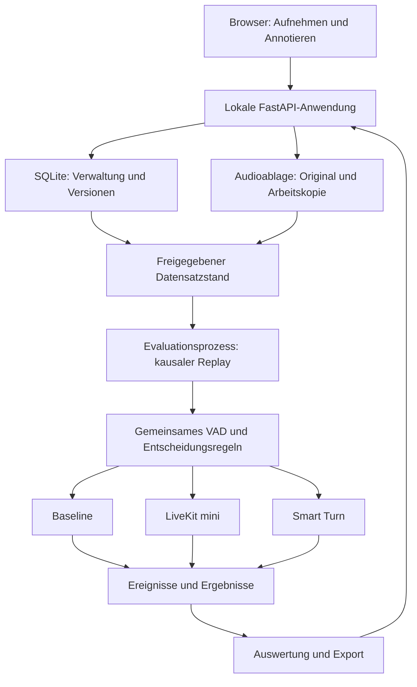

# Implementierungs- und Aufnahmeplan für den EOT-Prototyp

**Thema:** End-of-Turn Detection in deutschsprachigen Voicebots: Ein empirischer Vergleich semantischer und pausenbasierter Verfahren  
**Stand:** 12. November 2026  
**Status:** Ursprünglicher Umsetzungsplan. Der Prototyp und 100 Aufnahmekarten sind seit dem 12. November 2026 implementiert; die Hauptaufnahmen stehen noch aus. Der tatsächliche Funktionsumfang, die Bedienung und Abweichungen zu Planungsannahmen stehen in der [README](./README.md).  
**Grundlage:** [Wissenschaftlicher Projektplan](./PROJEKTPLAN_TURN_END_ERKENNUNG.md).

**Aktueller Workflow:** Auf Nutzerwunsch erfolgt die Haupterhebung vollständig synthetisch. Die Anwendung startet nun im Bereich **Erzeugen** und erstellt Audiodateien, Pausenvarianten und Referenzmarken automatisch. Der ursprüngliche manuelle Aufnahmeweg bleibt optional. Die umgesetzte synthetische Pipeline und die benötigte lokale ElevenLabs-Konfiguration stehen in der [README](./README.md#synthetischen-pilotdatensatz-erzeugen).

**Aktuelle Modellwahl:** Im implementierten Vergleich ist jetzt **LiveKit v1 Cloud** die Standardvariante; lokales v1-mini bleibt auswählbar. Cloud benötigt einen Projektzugang, läuft nur im Echtzeitmodus und zählt Netzwerk-/Dienstverarbeitung zur Aufrufdauer. Ein unbemerkter Modell-Fallback ist deaktiviert. Die nachfolgenden mini-Empfehlungen sind ursprüngliche Planungsannahmen; die verbindliche Bedienung und Grenzen stehen in der [README](./README.md#modelle-und-zugänge).

## 1. Entscheidung: Erst das Werkzeug bauen, dann die 100 Aufnahmen sammeln

Wir bauen zunächst eine lokal laufende Anwendung, mit der wir Audio aufnehmen, Aufnahmen prüfen und annotieren sowie dieselben Audiodaten durch unterschiedliche Turn-End-Verfahren schicken können. Erst wenn dieser Ablauf mit wenigen Pilotaufnahmen funktioniert, bitten wir die übrigen Personen zu ihren Aufnahmesitzungen.

Das vermeidet, dass nach 100 Aufnahmen ein ungeeignetes Audioformat, fehlende Nachlaufzeit oder unbrauchbare Zeitmarken auffallen.

Die Anwendung hat vier Arbeitsbereiche:

1. **Aufnehmen:** Szenariokarte anzeigen, Mikrofon prüfen, Beitrag aufnehmen, anhören und übernehmen.
2. **Annotieren:** Tatsächliches Beitragsende und interne Pausen anhand der Aufnahme markieren.
3. **Vergleichen:** Konfiguration auswählen und reproduzierbare Evaluationsläufe starten.
4. **Auswerten:** Ergebnisse, Fehlerfälle und Zeitachsen ansehen und exportieren.

Für den Hauptdatensatz empfehlen wir **fünf erwachsene Personen mit jeweils 20 Beiträgen**. Das ergibt genau 100 verwertbare Aufnahmen. Alters- und Stimmvielfalt ist erwünscht. Mit fünf Personen können wir aber keine belastbaren Aussagen darüber treffen, welche Alters- oder Geschlechtsgruppe ein Modell generell besser versteht.

## 2. Was die erste Version leisten soll

### 2.1 Funktionsumfang

Die erste benutzbare Version unterstützt:

- Teilnehmerkennungen und Aufnahmefortschritt;
- vorbereitete Szenariokarten mit fiktiven Angaben;
- Mikrofonaufnahme im Browser mit kontrollierter Nachlaufzeit;
- Wiederholen und begründetes Verwerfen technisch misslungener Versuche;
- einheitliche Audio-Arbeitskopien;
- manuelle Gold-Annotation mit Wellenform und Audioplayer;
- Silero-VAD-Baseline, LiveKit v1-mini und Smart Turn v3.2 als getrennte Adapter;
- chronologischen Audio-Replay ohne zukünftiges Audio;
- festgehaltene Konfigurationen und versionierte Datensatzstände;
- exportierbare Ereignisprotokolle, Ergebnistabellen und Diagramme.

Als erster vertikaler Durchstich genügt: **Eine Aufnahme erstellen, ihren Endzeitpunkt markieren, die Baseline ausführen und ein korrekt berechnetes Ergebnis anzeigen.** Anschließend kommen die beiden semantischen Adapter dazu.

### 2.2 Umfang begrenzen

Wir verwenden eine lokale Anwendung und zunächst ein gemeinsames Aufnahmegerät. Ein öffentliches Portal, Benutzerkonten, verteilte Infrastruktur oder eine vollständige Telefonieanbindung sind für die Untersuchung nicht erforderlich.

Die Modelle dürfen während der Hauptaufnahmen nicht reagieren. Andernfalls würden sie die Sprecher zum Umformulieren oder Abbrechen bewegen und damit ihre eigenen Testdaten beeinflussen. Live-Rückmeldungen eines Voicebots sind eine spätere, getrennte Demo.

## 3. Technischer Aufbau

### 3.1 Vorgeschlagener Stack

| Baustein | Entscheidung und Zweck |
|---|---|
| Oberfläche | HTML, CSS und JavaScript; kleine lokale Browseroberfläche ohne zusätzliches Frontend-Buildsystem. |
| Backend | Python mit FastAPI für Szenarien, Uploads, Annotationen und Ergebnisabfragen. |
| Verwaltung | SQLite für Personenkennungen, Szenarien, Versuche, Freigaben und Laufstatus. |
| Audioablage | Dateien auf der Festplatte; Metadaten und Prüfsummen in der Datenbank. |
| Browseraufnahme | Web Audio API mit AudioWorklet für unkomprimierte Audiosamples. |
| Audioverarbeitung | NumPy, SoundFile und bei Bedarf SciPy für die einmalige Konvertierung. |
| Modelle | Silero VAD, LiveKit v1-mini und Smart Turn v3.2; konkrete Revisionen werden im Integrationspilot festgeschrieben. |
| Auswertung | Pandas und Matplotlib für CSV-Tabellen und exportierbare Abbildungen. |
| Ausführung | Eigenständiger Python-Evaluationsprozess, den die Oberfläche starten und beobachten kann. |
| Verifikation | Gezielte automatisierte Tests für Zeitachsen, Entscheidungen, Datensatzfreigabe und Metriken. |

Diese Auswahl ist eine Implementierungsempfehlung. Sie setzt keine bereits installierten Pakete oder erfolgreich getestete Modellkompatibilität voraus.

### 3.2 Komponenten und Datenfluss



Der Rechenkern muss auch ohne Browser ausführbar sein. Dadurch lässt sich ein Versuch später mit derselben Datensatzversion und derselben Konfiguration erneut starten.

### 3.3 Ausführung der Modellläufe

Ein längerer Evaluationslauf läuft außerhalb des Webservers in einem separaten Prozess. Der Server verwaltet lediglich Start, Status, Abbruch und Ergebniszugriff. Die FastAPI-Dokumentation unterscheidet einfache Hintergrundaufgaben von aufwendigerer Hintergrundberechnung [T4]. Für diesen lokalen Prototyp reicht ein einzelner Worker; zusätzliche Queue-Dienste sind nicht nötig.

Läufe haben die Zustände `queued`, `running`, `completed`, `failed`, `cancelled` oder nach einem unerwarteten Abbruch `interrupted`. Ein abgebrochener Lauf gilt nicht als vollständiges Ergebnis. Bereits geschriebene Ereignisse bleiben erhalten.

Die drei Verfahren werden für Laufzeitmessungen nacheinander ausgeführt. CPU-Threads und Ausführungsprovider werden dokumentiert; ONNX Runtime bietet entsprechende Einstellungen [T5]. Auch Aufnahmesitzungen und aufwendige Auswertungsanimationen finden nicht gleichzeitig mit den finalen Laufzeitmessungen statt.

## 4. Aufnahmeoberfläche: So soll sie sich bedienen lassen

### 4.1 Übersicht

Die Startansicht zeigt:

- gewählte Person, beispielsweise `P03`;
- Fortschritt, beispielsweise „12 von 20 Beiträgen übernommen“;
- die nächste Szenariokarte;
- den Aufnahmestatus und einen einfachen Eingangspegel;
- die letzten gespeicherten Aufnahmen zum Wiederanhören.

In der Aufnahmeansicht stehen verständliche Aufgaben. Modellnamen, Schwellen und Evaluationsparameter gehören in den separaten Vergleichsbereich.

### 4.2 Ablauf einer einzelnen Aufnahme

1. **Karte lesen:** Die Person versteht Anliegen und fiktive Angaben. Das Mikrofon nimmt noch nicht auf.
2. **Vorbereiten:** Der Versuchsleiter klärt gegebenenfalls Wörter oder die Aussprache einer Nummer. Es gibt keinen Druck, einen exakten Wortlaut zu treffen.
3. **Starten:** Ein visueller Countdown endet, bevor die eigentliche Aufnahme beginnt. Ein Signalton darf nicht Teil des gespeicherten Beitrags sein.
4. **Sprechen:** Die Person führt die Aufgabe in einem zusammenhängenden Beitrag aus. Interne Pausen bleiben erhalten.
5. **„Beitrag fertig“ drücken:** Danach zeichnet die Anwendung weitere sechs Sekunden Raumton auf und stoppt automatisch. Das Mikrofon wird erst danach freigegeben.
6. **Anhören:** Die Person und der Versuchsleiter prüfen Aufnahme und Aufgabenverständnis.
7. **Übernehmen oder wiederholen:** Ein technisch brauchbarer Versuch wird übernommen; eine Wiederholung braucht einen dokumentierten Grund.

Der Klick auf „Beitrag fertig“ ist nur eine Bedienmarke. **Er wird nicht als tatsächliches Sprachende übernommen.** Dieses wird später im Audio markiert. Bei der Annotation wird auch geprüft, dass nach dem letzten gesprochenen Laut mindestens sechs Sekunden Beobachtungszeit verfügbar sind.

Die Aufnahme beendet sich nicht durch das zu untersuchende VAD und nicht durch einen semantischen Detektor.

### 4.3 Aufnahmezustände und Datensicherung

```text
bereit -> aufnahme_läuft -> nachlauf -> prüfen -> übernommen
                                      |
                                      +-> verworfen -> neuer Versuch
```

Jeder neue Versuch bekommt eine neue ID. Frühere Dateien werden nicht überschrieben. Pro Person und zugewiesener Szenariokarte kann genau ein Versuch für den Hauptkorpus ausgewählt werden.

Die Übernahme ist erst abgeschlossen, wenn der Server den Upload erfolgreich gespeichert und dessen Metadaten bestätigt hat. Bei einem Uploadfehler bleibt die Aufnahme zum erneuten Senden oder lokalen Herunterladen verfügbar. Doppelte Uploads derselben Versuch-ID erzeugen keine zusätzlichen Datensätze.

Ein Browserabsturz während der Aufnahme kann im MVP einen unvollständigen Versuch bedeuten. Dafür wird zuerst nur die aktuelle Karte wiederholt. Eine aufwendige Wiederherstellung laufender Mikrofonstreams gehört nicht zum Mindestumfang.

## 5. Audioqualität und technische Aufnahmebedingungen

### 5.1 Gleiche Bedingungen für alle Personen

Empfohlen sind dasselbe Mikrofon, derselbe Browser und ungefähr derselbe Abstand zum Mikrofon, beispielsweise 15–25 cm. Alle Personen sitzen in einem möglichst ruhigen Raum. Für diesen kleinen Datensatz werden Stimme und Sprechverhalten variiert; Geräte und Raumakustik werden möglichst konstant gehalten.

Vor jeder Sitzung wird eine kurze Probe angehört. Der Pegel soll verständlich sein und nicht übersteuern. Während interner Pausen wird möglichst nicht auf der Tastatur getippt oder mit Papier direkt am Mikrofon geraschelt.

Sprecher werden nicht gebeten, jünger, älter oder „typisch männlich/weiblich“ zu klingen. Wir verwenden ihre natürlichen Stimmen. Altersgruppe und eine freiwillige Selbstbeschreibung können dokumentiert werden; sie gehen nicht als Eingaben in die Modelle ein.

### 5.2 Browser und Dateiformat

Die Aufnahmefunktion nutzt `getUserMedia()` mit Mikrofonfreigabe und läuft zunächst auf `localhost`. Dafür ist ein geeigneter Browserkontext erforderlich; für entfernte Geräte ist ein HTTP-Aufruf über eine beliebige LAN-Adresse nicht automatisch ausreichend [T1].

AudioWorklet liefert die Samples der Web-Audio-Verarbeitung [T2]. Die tatsächlich verwendete Abtastrate wird aus dem AudioContext und den verfügbaren Geräteeinstellungen protokolliert [T3]. Eine gewünschte Rate wird nicht ungeprüft als tatsächlich erreichte Rate angenommen.

Wir speichern:

1. eine unveränderte Kopie der erfassten Samples mit ihrer tatsächlichen Abtastrate;
2. eine einmalig erzeugte **16-kHz-Mono-WAV-Arbeitskopie**, die alle Modelle erhalten;
3. Konvertierungseinstellungen, Kanalbehandlung, Dauer, Samplezahl und Prüfsummen.

Wenn eine Konvertierung nötig ist, wird ein festgelegtes Resampling-Verfahren verwendet, beispielsweise `scipy.signal.resample_poly` [T6]. Die Originaldatei bleibt erhalten. Gold-Zeitpunkte werden auf der 16-kHz-Arbeitskopie annotiert; deren Samples definieren die Zeitachse des Replay-Versuchs. Gemessen wird damit die Verarbeitung eines aufgezeichneten Signals, nicht die gesamte reale Mikrofon-Aufnahmelatenz.

Automatische Echo-Unterdrückung, Pegelregelung und Rauschunterdrückung werden möglichst einheitlich eingestellt; angefragte und tatsächlich verfügbare Einstellungen werden dokumentiert. Stille wird nicht automatisch herausgeschnitten. Ein Beitrag wird nicht nachträglich in fertig gesprochene Teilstücke zerlegt und zusammengesetzt.

### 5.3 Qualitätsprüfung ohne Auswahl nach Modellergebnis

Automatische Hinweise können leere Dateien, falsches Format, auffälliges Clipping und fehlende Nachlaufzeit melden. Ob gesprochen wurde, kann zusätzlich mit VAD vorgeschlagen werden. Ein VAD-Hinweis allein darf eine leise oder ungewöhnliche Stimme nicht automatisch ausschließen.

Ein Beitrag darf wiederholt werden bei:

- ausgefallener oder abgeschnittener Aufnahme;
- deutlich übersteuertem beziehungsweise unverständlichem Audio;
- störender fremder Sprache oder einem unbeabsichtigten technischen Signal;
- offensichtlich falsch verstandener Aufgabe;
- versehentlich gelesenen Regieanweisungen wie „Pause“.

Ein Beitrag wird nicht wiederholt, weil ein Modell ihn schwierig findet. Ein Versprecher kann gerade zur vorgesehenen Fallgruppe gehören.

## 6. Plan für genau 100 Aufnahmen

### 6.1 Personen

Empfohlen werden fünf erwachsene Personen mit unterschiedlichen natürlichen Stimmen und möglichst verschiedenen Altersgruppen. Ein möglicher Belegungsplan ist:

| Kennung | Beispiel für die Zusammenstellung | Beiträge |
|---|---|---:|
| P01 | Du oder eine andere erwachsene Person; Entwicklungssprecher | 20 |
| P02 | Eine weitere erwachsene Person mit anderer Stimme | 20 |
| P03 | Eine ältere erwachsene Frau | 20 |
| P04 | Ein älterer erwachsener Mann | 20 |
| P05 | Eine jüngere erwachsene Person | 20 |
| **Gesamt** | Die Profile sind Vorschläge, keine verbindlichen Quoten. | **100** |

Das kann mit Partnerin, Partner, Verwandten oder Bekannten organisiert werden. Entscheidend sind fünf unterschiedliche Personen, nicht fünf künstlich verstellte Stimmen. Die Rollen können entsprechend der tatsächlich verfügbaren Personen besetzt werden.

Falls nur vier Personen verfügbar sind, wäre eine dokumentierte Alternative viermal 25 Beiträge mit sprechergetrenntem Split von 25 Entwicklung und 75 Test. Dafür wird die Zuteilung neu ausgeglichen und im Projektplan als geänderte Datensatzversion festgehalten. Fünfmal 20 bleibt die einfachere Hauptempfehlung.

### 6.2 Fünf Inhaltsarten

| Code | Inhaltsart | Beispiele |
|---|---|---|
| K | Kundennummer | Ziffernfolge nennen, in Gruppen sprechen oder berichtigen. |
| E | E-Mail-Adresse | Namen, Punkt, Bindestrich, „at“, Domain oder Korrektur nennen. |
| A | Adresse oder Termin | Straße, Hausnummer, Datum und Uhrzeit nennen. |
| T | Technisches Anliegen | Ausfälle, Verbindungsprobleme oder Geräteverhalten beschreiben. |
| V | Vertrag oder Rechnung | Kündigung, Änderung oder eine unklare Rechnung erläutern. |

Fiktive E-Mail-Adressen verwenden die für Beispiele vorgesehenen Domains `example.com` oder `example.org` [T7]. Andere personenbezogene Angaben sind ebenfalls erfunden.

### 6.3 Vier Sprechverläufe

| Code | Verlauf | Was damit geprüft wird |
|---|---|---|
| F | Abgeschlossen und flüssig | Reagiert das System nach einem klaren Ende zügig? |
| U | Unvollständig mit Denkpause | Wartet es bei einer noch offenen Äußerung? |
| N | Vollständiger Satz mit Nachtrag | Wie geht es mit einem plausiblen, aber noch nicht endgültigen Übergabepunkt um? |
| R | Stocken, Aufzählung oder Selbstkorrektur | Kann es strukturierte Daten und Reparaturen abwarten? |

**Rechnung:** Fünf Inhaltsarten × vier Sprechverläufe × fünf Personen = **100 Aufnahmen**.

Jede Person deckt jede Kombination genau einmal ab. Dadurch gibt es je Inhaltsart 20 und je Sprechverlauf 25 Beiträge. Das entspricht den vier Fallgruppen des wissenschaftlichen Projektplans; die fünf Inhaltsarten kommen als zweite Beschreibungsebene dazu.

### 6.4 Die 20 Kartenarten pro Person

Die folgende Tabelle beschreibt die Aufgabenfamilien. Die Beispiele sind Anschauungsmaterial und noch kein identischer Vorlesetext für alle fünf Personen.

| Karte | Aufgabe und möglicher Verlauf |
|---|---|
| K-F | Kundennummer vollständig nennen: „Meine Kundennummer lautet 48273196.“ |
| K-U | Nach der Einleitung kurz nachdenken: „Meine Kundennummer ist … [Pause] … 73916428.“ |
| K-N | Nummer nennen und nach einem vollständigen Satz ergänzen: „Die Kundennummer ist 58192473. [Pause] Der Vertrag läuft auf meinen Namen.“ |
| K-R | Nummer berichtigen: „Die Nummer ist 6912 … [Pause] … Entschuldigung, 6913 und dann 4827.“ |
| E-F | Eine fiktive E-Mail-Adresse in einem Zug nennen. |
| E-U | Vor dem Domainnamen überlegen: „Meine E-Mail-Adresse ist lea.peters at … [Pause] … example Punkt org.“ |
| E-N | E-Mail-Adresse nennen, dann einen zweiten Wunsch ergänzen: „… [Pause] Schicken Sie mir die Bestätigung bitte dorthin.“ |
| E-R | Einen Bestandteil korrigieren: „tom Bindestrich … [Pause] … nein, tom Punkt berger at example Punkt com.“ |
| A-F | Eine Adresse oder einen Termin vollständig angeben. |
| A-U | Einen Bestandteil nachsehen: „Die neue Hausnummer ist … [Pause] … vierundzwanzig.“ |
| A-N | Einen Termin nennen und später ergänzen: „Am Dienstag um zehn passt es. [Pause] Bitte rufen Sie vorher kurz an.“ |
| A-R | Datum, Uhrzeit oder Hausnummer korrigieren. |
| T-F | Ein kurzes, abgeschlossenes technisches Problem schildern. |
| T-U | Nach einem offenen Satzteil nachdenken: „Die Verbindung bricht immer ab, wenn … [Pause] … ich ein Videogespräch starte.“ |
| T-N | Ein Problem vollständig nennen und ein weiteres Symptom ergänzen. |
| T-R | Den Fehlerverlauf stockend schildern oder eine Aussage berichtigen. |
| V-F | Einen klaren Vertrags- oder Rechnungswunsch äußern. |
| V-U | Einen fehlenden Zeitpunkt oder Grund ergänzen: „Ich möchte den Tarif wechseln, weil … [Pause] … ich mehr Datenvolumen brauche.“ |
| V-N | „Ich möchte kündigen. [Pause] Allerdings erst zum Ende der Laufzeit.“ |
| V-R | Betrag, Zeitraum oder Änderungswunsch korrigieren beziehungsweise aufzählen. |

### 6.5 Personenbezogene Varianten statt fünfmal derselbe Text

Die Software erhält **100 zugewiesene Szenariokarten**, also 20 pro Person. Jede Karte hat eine eigene `scenario_id` und die gemeinsamen Kategorien, zum Beispiel `content_type=email` und `turn_pattern=incomplete_pause`.

Für jede Kartenart werden unterschiedliche Szenarien, Formulierungen und fiktive Angaben vorbereitet. Besonders die 20 Entwicklungskarten unterscheiden sich in konkretem Wortlaut und Inhalt von den Testkarten. Es reicht dafür nicht, einen identischen vorgegebenen Satz lediglich mit einer anderen Nummer zu versehen.

Gleich bleiben die untersuchten Funktionen, etwa eine offene Einleitung vor einer Nummer. Funktional ähnliche Kategorien sind notwendig; identische Vorlesetexte, Kopien und bearbeitete Varianten derselben Aufnahme werden dagegen nicht auf Entwicklung und Test verteilt.

Vor der Erhebung wird die Kartensammlung manuell auf nahe Duplikate geprüft. Die Oberfläche zeigt eine pro Person mit festem Zufallsstartwert gemischte Reihenfolge. So kommen nicht immer erst alle Kundennummern und dann alle E-Mail-Adressen.

### 6.6 Beispiel einer fertigen Aufnahmekarte

> **Situation:** Ein Servicebot möchte deine Kundennummer wissen.  
> **Fiktive Angaben:** 73916428.  
> **Deine Aufgabe:** Sage zunächst, dass du die Nummer nennen möchtest. Halte kurz inne, als würdest du sie auf einem Zettel suchen, und nenne sie dann vollständig.  
> **Sprechweise:** Natürlich und in deinen eigenen Worten. Eine kurze Denkpause genügt; sprich das Wort „Pause“ nicht mit.  
> **Beispiel nur zur Orientierung:** „Meine Kundennummer ist … sieben drei neun eins sechs vier zwei acht.“

Die beabsichtigte interne Pause wird beim Vorbereiten erklärt. Es gibt keinen laufenden Countdown innerhalb des gesprochenen Beitrags. Tatsächliche Pausenlängen werden später aus dem Audio bestimmt; eine vermeintlich exakt eingehaltene Sekunde wird nicht als Wahrheit angenommen.

## 7. Aufnahmesitzungen praktisch durchführen

### 7.1 Vorbereitung durch dich

1. Die Software mit fünf bis zehn separaten Pilotaufnahmen prüfen.
2. Die 100 Szenariokarten vorbereiten und den fünf Personen zuweisen.
3. Fiktive Angaben, Aussprachehinweise und Reihenfolge prüfen.
4. Ruhigen Raum und gemeinsames Mikrofon festlegen.
5. Zweck der Aufnahme, Speicherung und Verwendung mit den Personen besprechen und Zustimmung dokumentieren.

Die Pilotaufnahmen zählen nicht zu den 100 freigegebenen Beiträgen. Ebenso erhöhen Wiederholungsversuche nicht die Fallzahl: Gezählt wird ein ausgewählter Versuch je zugewiesener Karte.

### 7.2 Zeit pro Person

Für die Terminplanung würde ich **ungefähr 20–30 Minuten je Person** reservieren, einschließlich Erklärung, Probe, 20 Beiträgen, kurzen Hörkontrollen und einzelnen Wiederholungen. Das ist eine organisatorische Schätzung, keine feste Aufnahmevorgabe.

Nach jeweils fünf Beiträgen kann eine kurze Pause gemacht werden. Die Oberfläche merkt sich den Fortschritt, damit eine Sitzung auch später fortgesetzt werden kann.

### 7.3 Was den Personen erklärt wird

Eine kurze, einheitliche Einweisung genügt:

> Wir untersuchen, wann ein Sprachsystem erkennen kann, dass du fertig gesprochen hast. Du bekommst kurze Alltagssituationen und erfundene Angaben. Sprich so, wie du es am Telefon tun würdest. Bei manchen Aufgaben sollst du kurz nachdenken oder etwas berichtigen. Es geht nicht darum, fehlerfrei zu sprechen. Wenn dein Beitrag fertig ist, drücke die Fertig-Schaltfläche und bleibe noch kurz ruhig, während die Aufnahme nachläuft.

Einen beispielhaften Versuch kann man vorführen. Die Teilnehmenden hören keine Modellergebnisse. Der Versuchsleiter beeinflusst nicht nachträglich die Sprechweise, um ein bestimmtes Modell besser oder schlechter aussehen zu lassen.

### 7.4 Abschluss einer Sitzung

Die Übersicht muss 20 übernommene Karten ausweisen. Danach werden Vollständigkeit, Nachlaufzeit und Zuordnung stichprobenartig geprüft und die Dateien gesichert. Technische Ausschlussgründe werden vor der Modellauswertung entschieden.

Die Sprecherkennungen stehen in den Datendateien. Eine eventuelle Zuordnung zu realen Namen wird getrennt von den exportierten Versuchsdaten aufbewahrt. Rohaufnahmen werden nur im vereinbarten Rahmen geteilt.

## 8. Annotation als eigener Arbeitsschritt

### 8.1 Oberfläche

Die Annotationsansicht zeigt die vollständige 16-kHz-Arbeitskopie mit:

- Audioplayer, langsamerer Wiedergabe und wiederholbarem Ausschnitt;
- Wellenform mit Zoom und Zeitposition;
- Markierung des letzten gesprochenen Lauts als Gold-Turn-Ende;
- Bereichen für interne HOLD-Pausen;
- Transkript, Mehrdeutigkeitsmarkierung und kurzer Notiz;
- Prüfstatus und Name beziehungsweise Kennung des Prüfers.

Der Fertig-Klick aus der Aufnahme kann als Orientierung eingeblendet werden, wird aber nicht automatisch zur Gold-Marke. Modellentscheidungen bleiben während der Gold-Annotation ausgeblendet.

### 8.2 Zeitmarken und Freigabe

Die primären Zeitmarken werden als Samplepositionen in der 16-kHz-Arbeitskopie gespeichert. Millisekunden werden daraus berechnet:

```text
Zeit in Millisekunden = Sampleposition / 16000 × 1000
```

Zu jedem Beitrag gehören mindestens das Gold-Turn-Ende, erkannte interne Pausen, Fallgruppe und Prüfstatus. Der Gold-Endzeitpunkt beschreibt den letzten gesprochenen Laut; Atmen, Mausklicks und Raumgeräusche gelten nicht automatisch als Sprache.

Die natürlich mehrdeutigen Nachtrag-Fälle werden entsprechend markiert. Bei ihnen ist zusätzlich zu berichten, dass ein früherer Übergabepunkt ohne Zukunftswissen plausibel war.

Mindestens 20–25 Aufnahmen werden von einer zweiten Person geprüft. Das umfasst alle Inhaltsarten und Sprechverläufe. Unterschiedliche Endzeitmarken und HOLD/EOT-Interpretationen werden vor dem finalen Test besprochen und dokumentiert.

## 9. Datenmodell und versionierte Ablage

### 9.1 Verwaltungstabellen

| Entität | Wesentliche Daten |
|---|---|
| `participants` | Kennung, optionale Altersgruppe, freiwillige Beschreibung, Entwicklungs-/Testzuordnung. |
| `scenarios` | Aufgabe, fiktive Angaben, Kartenart, Personenzuordnung, Version. |
| `attempts` | Aufnahme-ID, Karte, Original, Arbeitskopie, Formate, Qualitätsstatus, Wiederholungsgrund. |
| `annotations` | Samplepositionen, HOLD-Bereiche, Gold-Ende, Mehrdeutigkeit, Prüfer, Revision. |
| `dataset_releases` | Ausgewählte Versuche, feste Annotationen, Split, Prüfsummen. |
| `runs` | Datensatzstand, Verfahren, Modellrevisionen, Konfiguration, Hardware und Status. |

Große Ereignisprotokolle werden als JSONL neben dem Lauf gespeichert. SQLite verwaltet deren Zuordnung und die Zusammenfassungen. Aus einer freigegebenen Version lässt sich ein portables Manifest erzeugen; das Forschungsformat hängt damit nicht von der Weboberfläche ab.

### 9.2 Auswahl und Einfrieren des Datensatzes

Für die Hauptempfehlung gilt:

- `P01`: 20 Entwicklungsbeiträge;
- `P02` bis `P05`: insgesamt 80 Testbeiträge.

Die Zuteilung wird vor der Parameterauswahl festgelegt. Die konkrete Person für `P01` kann vor Beginn gewählt werden. Ein späterer Tausch aufgrund eines Modellergebnisses ist nicht vorgesehen.

Ein Datensatzstand referenziert genau einen ausgewählten Versuch je Karte und genau eine Annotationsrevision. Eine spätere Korrektur erzeugt einen neuen Stand. Bestehende Ergebnisse bleiben mit dem ursprünglichen Stand verknüpft.

Mögliche Statusfolge:

```text
aufgenommen -> qualitätsgeprüft -> annotiert -> gegengeprüft -> freigegeben
```

Der Export prüft unter anderem: 100 ausgewählte Beiträge, 20 je Person, 20 je Inhaltsart, 25 je Sprechverlauf, 20 Entwicklung und 80 Test sowie gültige Zeitmarken. Bei einer bewusst geänderten Sprecherzahl gelten die Regeln der dokumentierten neuen Planversion.

## 10. Evaluationskern und Modelladapter

### 10.1 Gemeinsamer Adaptervertrag

Die Adapter erhalten ausschließlich bereits freigegebenes Audio des aktuellen Beitrags und erlaubte technische Einstellungen. Ein Adapter bekommt keine Gold-Marken, Solltexte, Pausenlabels, Dateigesamtdauer, Personenkategorien oder Szenarioanweisungen.

Ein Ergebnis enthält:

- Ende des verwendeten Audiopräfixes;
- Beginn und Ende der Berechnung;
- Turn-End-Score mit dokumentierter Bedeutung oder ein echtes SDK-Ereignis;
- tatsächlich verwendetes Modell und Revision;
- Modellfehler beziehungsweise Fallback-Status.

Der Evaluator lädt Gold-Daten getrennt und verbindet sie erst nach dem Lauf mit den Ereignissen. Für die Hauptmodelle gelten weiterhin die Auswahl und Quellen des [Projektplans](./PROJEKTPLAN_TURN_END_ERKENNUNG.md).

### 10.2 B0: Baseline

Silero VAD verarbeitet fortlaufend dieselben Audio-Arbeitskopien wie die semantischen Systeme. Ein Timer beendet den Beitrag nach der gewählten Dauer Nicht-Sprache. Wenn das VAD selbst eine Stille-Bestätigungszeit enthält, muss die Implementierung diese nachvollziehbar berücksichtigen und darf sie nicht unbemerkt zweimal addieren.

Die bereits geplanten Stillezeiten von 300 bis 3.000 ms werden unterstützt. Ein gewählter Wert wird im Laufmanifest gespeichert. Die Baseline bildet einen vollständigen Durchstich der Pipeline, bevor echte semantische Modelle integriert werden.

### 10.3 M1 und M2: Semantische Adapter

Geplant bleiben LiveKit v1-mini und die CPU-ONNX-Variante von Smart Turn v3.2. Die Modellbezeichnungen sind die vorgesehenen Vergleichsbedingungen aus dem bisherigen Plan; sie sind keine Aussage über den am heutigen Datum neuesten Anbieterstand.

Beide Adapter kapseln ihre native Vorverarbeitung und ihr Kontextfenster. Die Software behauptet nicht, dass beide denselben internen Kontext verwenden. Längere E-Mail-Adressen und Anliegen können das ungefähr achtsekündige Smart-Turn-Kontextfenster überschreiten. Diese Fälle werden dokumentiert und nicht nachträglich entfernt, um ein Modell zu begünstigen.

Die Integration beginnt mit wenigen Probeaufnahmen und prüft Score-Richtung, deutsche Einstellung, Modellrevision und Zugriff auf die Entscheidungsparameter. Wenn sich nur komplette SDK-Entscheidungen messen lassen, kennzeichnen wir die Bedingung als Systemvergleich. Eine gehostete LiveKit-Variante bleibt ein separat ausgewiesener Ersatz oder Zusatz.

### 10.4 Entscheidungslogik und ausstehende Ergebnisse

Geplante Zustände sind `speech`, `silence_candidate` und `committed`. Ein separater Fehlerstatus beendet einen fehlgeschlagenen Lauf nachvollziehbar.

Semantische Modelle prüfen nach der festgelegten Mindestpause und gegebenenfalls in weiteren Intervallen, ob der Turn beendet ist. Spätestens nach der gemeinsamen maximalen Wartezeit greift der festgelegte Timeout. Die konkreten Parameter werden am Entwicklungssatz bestimmt.

Jeder neue Sprachabschnitt erhöht eine interne Sprachphasen-ID. Ein asynchron fertig werdender Score gehört zu der Phase und dem Audiopräfix, für die er angefordert wurde. Hat die Person inzwischen wieder gesprochen, wird ein veraltetes Ergebnis verworfen. Pro Modell ist höchstens eine Inferenz gleichzeitig ausstehend; die Anwendung baut keine unbegrenzte Warteschlange alter Präfixe auf.

### 10.5 Echtzeit-Replay und messbare Entscheidungen

Die Abfolge der Audiosamples wird an einer monotonen Uhr ausgerichtet. Das Quell-Audio wird in 1×-Geschwindigkeit freigegeben. Modellinferenz darf diese Freigabe nicht durch einen blockierenden Aufruf im gleichen Ablauf anhalten. Dafür werden Eingabefreigabe und rechenintensive Inferenz getrennt geplant.

Die erste Audiofreigabe startet die gemeinsame Zeitachse. Die Verfügbarkeit eines Scores wird erst nach Ende der Berechnung gemessen. Als Turn-Abschlusszeit zählt der Zeitpunkt, zu dem die Anwendung tatsächlich wirksam abschließt, nicht rückwirkend das Ende des ausgewerteten Audiopräfixes.

Wenn ein früher Commit entsteht, bleibt er das Ergebnis der Aufnahme. Die späteren Samples dürfen diesen Commit nicht rückwirkend verbessern. Nach dem Test können unabhängige Analyseansichten den gesamten Verlauf darstellen, müssen ihn aber von der tatsächlich wirksamen Entscheidung unterscheiden.

Replay-Rückstand und übersprungene Inferenzabfragen werden protokolliert. Ist ein Verfahren auf der Zielhardware nicht echtzeitfähig, wird das als Eigenschaft der Messung sichtbar.

## 11. Ergebnisansicht und Export

### 11.1 Übersicht

Die Haupttabelle zeigt je Verfahren und Konfiguration:

- vorzeitige Abschlüsse als Anzahl und Prozentwert;
- Endpointing-Latenz als Median und 95. Perzentil samt Anzahl auswertbarer Beiträge;
- Fallback-Rate der semantischen Verfahren;
- Inferenzzeit je Aufruf und aufsummiert je Beitrag;
- technische Fehler und fehlende Entscheidungen.

Vorzeitige Abschlüsse gehen nicht als negative Latenzen ein. Korrekt nach dem Gold-Ende liegende Timeout-Entscheidungen bleiben in der Latenz enthalten. Fehlgeschlagene Beispiele verschwinden nicht aus dem Gesamtbild.

### 11.2 Fallansicht

Für eine ausgewählte Aufnahme zeigt die Software dieselbe Audiozeitachse für:

1. Wellenform und Gold-Ende;
2. interne HOLD-Pausen;
3. VAD-Sprachaktivität;
4. wirksamen Commit jedes Verfahrens;
5. Anlass des Commits und relevante Inferenzzeit.

Filter nach Inhaltsart, Sprechverlauf und Person helfen bei der Fehleranalyse. Einzelne Personen werden deskriptiv betrachtet; aus dieser kleinen Stichprobe werden keine allgemeinen Alters- oder Geschlechtseffekte abgeleitet.

### 11.3 Reproduzierbare Exporte

Ein Laufverzeichnis enthält Konfiguration und Modellstände, Datensatzprüfsummen, Ereignisse, eine Ergebnistabelle pro Beitrag und aggregierte Ergebnisse. Die Abbildungen werden aus diesen gespeicherten Tabellen erzeugt.

Entwicklungsergebnisse dürfen Parameterentscheidungen unterstützen. Die finale Testansicht wird erst nach dem Festschreiben der Konfigurationen ausgeführt. Damit bleibt nachvollziehbar, welche Entscheidungen vor und nach dem Test gefallen sind.

## 12. Geplante Projektstruktur

Die folgende Struktur beschreibt zukünftige Dateien, nicht bereits implementierte Software:

```text
app/
  main.py                    # Webserver und lokale API
  database.py                # SQLite-Zugriff
  schemas.py                 # Eingabe- und Exportmodelle
  recording_service.py       # Upload, Konvertierung und Qualitätsprüfung
  annotation_service.py      # Zeitmarken, Revisionen und Freigaben
  dataset_service.py         # Split und unveränderliche Exporte
  run_service.py             # Start, Status und Abbruch von Läufen
  static/
    index.html
    app.css
    recorder.js
    audio-worklet.js
    annotation.js
    results.js
eot_eval/
  replay.py                  # Audiofreigabe mit Audio- und Laufzeitachse
  vad.py                     # gemeinsames VAD
  endpointing.py             # Pausenregel, Score-Schwelle und Commit
  adapters/
    baseline.py
    livekit_mini.py
    smart_turn.py
    fixture.py               # kontrolliertes Verhalten für Verifikation
  metrics.py
  reports.py
  cli.py
configs/
  pilot.yaml
  development.yaml
  final.yaml
data/
  scenarios/                 # zugewiesene Aufnahmekarten
  originals/
  canonical/                 # einheitliche 16-kHz-Arbeitskopien
  releases/
results/
  <run_id>/
tests/
  fixtures/
```

Benötigte Konfigurationen sind beispielsweise Projektablage, Teilnehmerzuordnungen, Mikrofoneinstellungen, Nachlaufdauer, Baseline-Timeout, Inferenzintervall, semantische Schwellen und maximaler Timeout. Zugangsdaten für optionale Dienste stehen außerhalb dieser Dateien in der Laufzeitumgebung.

## 13. Reihenfolge der Implementierung mit Abnahmekriterien

| Schritt | Was gebaut wird | Erkennbar fertig, wenn … |
|---|---|---|
| 1 | Datenverträge, CLI-Grundgerüst und kontrollierter Testadapter | Eine kleine Beispielaufnahme zu erwartbaren Entscheidungen und Metriken führt. |
| 2 | Baseline, Audiozeitachse und Ereignisprotokoll | Timer, Sprachwiederbeginn und erste Commit-Entscheidung korrekt nachvollziehbar sind. |
| 3 | Aufnahmeoberfläche, Szenariozuordnung und Speichern | Eine Person eine Karte aufnehmen, anhören, wiederholen und dauerhaft übernehmen kann. |
| 4 | Annotation und Datensatzexport | Ein manuell markierter Beitrag unverändert in einem freigegebenen Manifest erscheint. |
| 5 | LiveKit-mini- und Smart-Turn-Adapter | Beide auf Pilotaufnahmen kausal laufen und ihre Laufzeiten protokollieren. |
| 6 | Ergebnisansicht, Diagramme und Versionsprotokolle | Dieselbe Aufnahme für alle drei Verfahren samt Gold-Marke vergleichbar ist. |
| 7 | Aufnahme-Generalprobe | Ein Durchlauf von zehn Karten ohne Datenverlust oder manuelles Dateiumbenennen funktioniert. |
| 8 | Erstellung und Prüfung der 100 zugewiesenen Karten | Personen, Inhalte und Sprechverläufe vollständig und passend verteilt sind. |
| 9 | Hauptaufnahmen und Annotation | Genau 100 qualitätsgeprüfte und annotierte Beiträge vorliegen. |
| 10 | Parameterauswahl und endgültiger Test | Konfigurationen vor dem Test feststehen und vollständige Ergebnisse exportiert sind. |

Die Oberfläche für das Aufnehmen darf früh entstehen; die Hauptsitzungen finden erst nach der Generalprobe statt. Für die vollständige Software würde ich grob acht bis zwölf konzentrierte Arbeitstage einplanen, abhängig von den Modell-Schnittstellen. Aufnahme und Annotation werden gesondert terminiert. Das ist eine Aufwandsschätzung und kein zugesagter Liefertermin.

## 14. Gezielte technische Verifikation

Die Tests konzentrieren sich auf Fehler, die die Forschungsergebnisse verfälschen könnten:

| Fall | Erwartetes Verhalten |
|---|---|
| Eine kurze Pause, dann erneute Sprache | Der Baseline-Timer wird zurückgesetzt. |
| Ein Score ist nach Sprachwiederbeginn fertig | Ein veralteter Commit wird verworfen. |
| Die Inferenz dauert länger als das Prüfintervall | Keine unbegrenzte Warteschlange; tatsächliche Verzögerung wird sichtbar. |
| Ein Adapter versucht zukünftige Samples zu lesen | Die Adapter-Schnittstelle stellt sie nicht bereit; der kausale Test schlägt sonst fehl. |
| Ein früher Commit, später ein korrektes Ende | Der frühe Commit bleibt als Fehler bestehen. |
| Keine semantische EOT-Entscheidung | Der konfigurierte Fallback wird ausgelöst und als solcher gezählt. |
| Eine Entscheidung bleibt vollständig aus | Der Fall wird als fehlende Entscheidung berichtet. |
| Dieselbe Aufnahme wird zweimal hochgeladen | Es entsteht kein doppelter akzeptierter Beitrag. |
| Eine freigegebene Annotation wird geändert | Ein neuer Datensatzstand entsteht; alte Ergebnisse behalten ihre Referenz. |
| Eine Wiederholung derselben Karte wird gespeichert | Nur ein ausgewählter Versuch zählt zu den 100. |
| Ein bekannter künstlicher Ereignissatz | Abbruchrate, Median und Fallback-Zähler stimmen mit den vorher berechneten Erwartungen überein. |

Für den kausalen Softwaretest kann ein künstlicher Audiostrom benutzt werden, der nach einem bestimmten Zeitpunkt deutlich verändert wird: Vor diesem Zeitpunkt muss das Verhalten unverändert bleiben. Solche technischen Fixtures dienen der Verifikation und zählen nicht zu den menschlichen Testaufnahmen.

## 15. Rolle von LiveKit und ElevenLabs beim Bau

LiveKit wird für den Modelladapter genutzt und kann später die Live-Demo tragen. Die vorhandenen Zugangsmöglichkeiten werden im Integrationspilot geprüft; für die geplante lokale Mini-Variante sollte die Messung möglichst ohne Netzwerk-Roundtrip auskommen.

ElevenLabs wird zunächst für eine hörbare Demoantwort nach dem Turn-Ende eingeplant. Die Antwort kann vorab erzeugt werden. Dadurch kann die Präsentation zeigen, an welcher Stelle ein Bot antworten würde, ohne die eigentliche EOT-Auswertung mit Generierungs- oder TTS-Latenz zu vermischen.

Die 100 Hauptaufnahmen sind menschliche Sprache. Synthetische Stimmen können später einen zusätzlichen, getrennt gekennzeichneten Belastungstest bilden. Sie ersetzen nicht die tatsächliche Stimmvielfalt der fünf Personen.

## 16. Beispiel eines vollständigen späteren Arbeitsablaufs

1. Du startest die lokale Anwendung und legst `P01` bis `P05` an.
2. Die Kartenverwaltung importiert die 100 vorbereiteten Zuordnungen.
3. Eine Person nimmt ihre 20 Karten auf; nach jeder Karte wird der Versuch geprüft und übernommen.
4. Du annotierst die übernommenen Beiträge und lässt die vereinbarte Stichprobe gegenprüfen.
5. Die Anwendung exportiert einen festen Datensatzstand mit 20 Entwicklungs- und 80 Testbeiträgen.
6. Du startest Entwicklungsvergleiche, wählst Schwellen und speicherst die finale Konfiguration.
7. Der Worker führt die Testmessungen nacheinander aus und schreibt die tatsächlichen Ereignisse.
8. Die Ergebnisansicht stellt Abbruchrate und Latenz gegenüber und erlaubt das Anhören von Fehlerfällen.
9. Du exportierst Tabelle und Abbildungen für die Seminararbeit sowie einige anschauliche Beispiele für die Präsentation.

## 17. Abnahme des Prototyps vor den Hauptaufnahmen

Vor dem Termin mit den fünf Personen muss die Generalprobe bestätigen:

- Eine vollständige Sitzung kann gespeichert, geschlossen und wieder geöffnet werden.
- Mikrofon, Pegel, Samplezahlen und Nachlaufzeit sind überprüft.
- Arbeitskopien lassen sich korrekt anhören; die Originale bleiben erhalten.
- Annotationen beziehen sich auf dieselbe Zeitachse wie die späteren Modellläufe.
- Die Baseline und beide semantischen Adapter laufen auf Pilotdaten.
- Ein Fall mit interner Pause und ein Fall mit klarem Ende sind in der Ergebnisansicht verständlich sichtbar.
- Eine manuell nachvollzogene Beispielmessung stimmt mit den berechneten Ergebnissen überein.
- Alle ausgewählten Aufnahmen und Metadaten können gesichert und exportiert werden.

**Nächster Umsetzungsschritt:** Den vertikalen Durchstich aus einer Aufnahme, manueller Endmarkierung, Baseline-Replay und Ergebnisanzeige implementieren. Danach werden die semantischen Adapter integriert und erst anschließend die Hauptaufnahmen gesammelt.

## 18. Technische Referenzen

Die Modell- und Forschungsliteratur steht im [wissenschaftlichen Projektplan](./PROJEKTPLAN_TURN_END_ERKENNUNG.md). Für die neu konkretisierte Softwarearchitektur wurden die folgenden technischen Referenzen geprüft; Abrufdatum ist jeweils der 12. November 2026.

- **T1:** MDN, [MediaDevices.getUserMedia()](https://developer.mozilla.org/en-US/docs/Web/API/MediaDevices/getUserMedia). Mikrofonfreigabe und geeigneter Browserkontext.
- **T2:** MDN, [AudioWorklet](https://developer.mozilla.org/en-US/docs/Web/API/AudioWorklet). Audioverarbeitung und Sampleübergabe im Browser.
- **T3:** MDN, [BaseAudioContext.sampleRate](https://developer.mozilla.org/en-US/docs/Web/API/BaseAudioContext/sampleRate). Tatsächliche Abtastrate des AudioContext.
- **T4:** FastAPI, [Background Tasks](https://fastapi.tiangolo.com/tutorial/background-tasks/). Abgrenzung einfacher Hintergrundaufgaben von aufwendiger Berechnung.
- **T5:** ONNX Runtime, [Thread management](https://onnxruntime.ai/docs/performance/tune-performance/threading.html). Dokumentierbare CPU-Thread-Konfiguration.
- **T6:** SciPy, [resample_poly](https://docs.scipy.org/doc/scipy/reference/generated/scipy.signal.resample_poly.html). Festlegbares Resampling der Arbeitskopien.
- **T7:** IANA, [Example Domains](https://www.iana.org/help/example-domains). Geeignete Domains für fiktive E-Mail-Adressen.

[T1]: https://developer.mozilla.org/en-US/docs/Web/API/MediaDevices/getUserMedia
[T2]: https://developer.mozilla.org/en-US/docs/Web/API/AudioWorklet
[T3]: https://developer.mozilla.org/en-US/docs/Web/API/BaseAudioContext/sampleRate
[T4]: https://fastapi.tiangolo.com/tutorial/background-tasks/
[T5]: https://onnxruntime.ai/docs/performance/tune-performance/threading.html
[T6]: https://docs.scipy.org/doc/scipy/reference/generated/scipy.signal.resample_poly.html
[T7]: https://www.iana.org/help/example-domains
