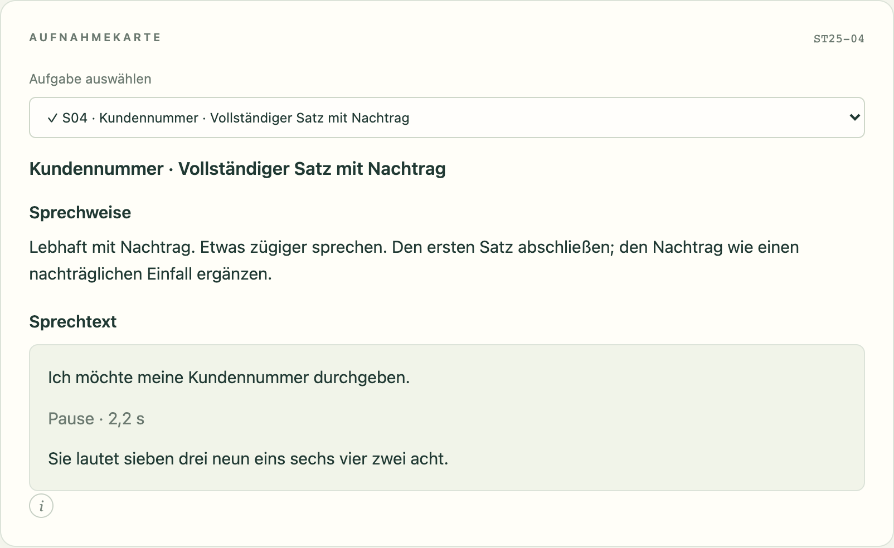
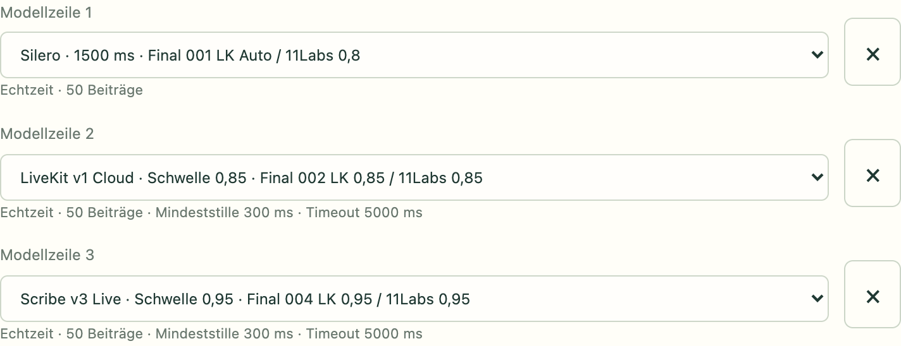
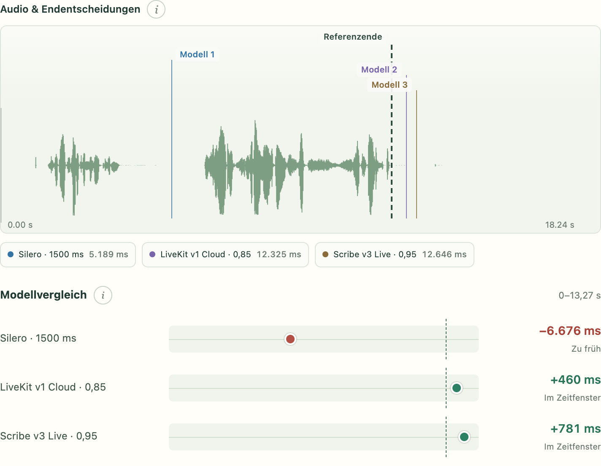
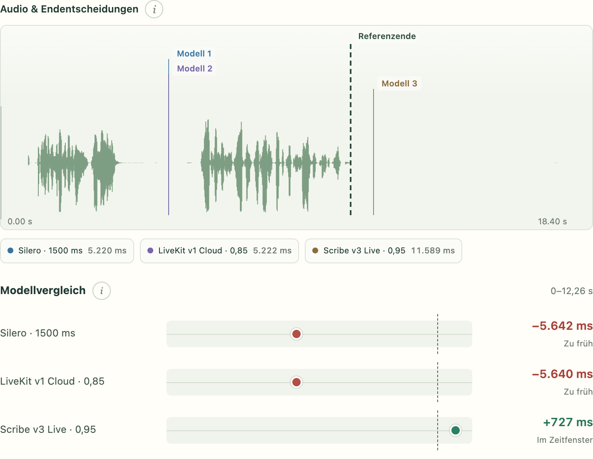
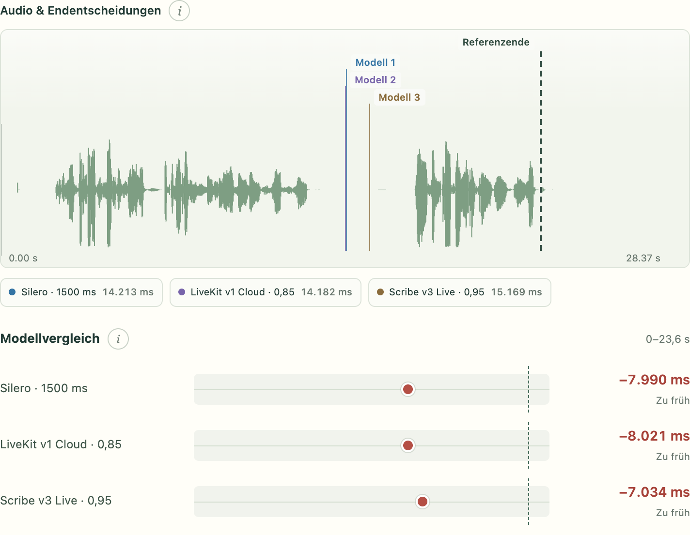

# Anhang

## Anhang A Digitale Projektbeilage

Die ZIP-Beilage enthält EOT Lab mit Quellcode, 50 Audiodateien, Referenzannotationen und Messergebnissen. Installation und Bedienung sind in der beigefügten Projektbeschreibung erläutert.

## Anhang B Szenarienkatalog und Sprechvorgaben

Jedes Szenario liegt als Eigenaufnahme und als synthetische Aufnahme vor. Die Pausenmarkierungen sind geplante Zielwerte und werden nicht mitgesprochen.

**Tabelle B1 Vollständige Sprechtexte und Pausenvorgaben**

| ID | Inhaltsart und Verlauf | Sprechtext |
| --- | --- | --- |
| S01 | Kundennummer Flüssig ohne Zusatzpause | Meine Kundennummer ist sieben drei neun eins sechs vier zwei acht. |
| S02 | Kundennummer Denkpause 0,4 s | Meine Kundennummer ist sieben drei neun eins [Pause 0,4 s] sechs vier zwei acht. |
| S03 | Kundennummer Selbstkorrektur 0,7 s | Meine Kundennummer ist sieben drei neun zwei, [Pause 0,7 s] Entschuldigung, sieben drei neun eins sechs vier zwei acht. |
| S04 | Kundennummer Nachtrag 2,2 s | Ich möchte meine Kundennummer durchgeben. [Pause 2,2 s] Sie lautet sieben drei neun eins sechs vier zwei acht. |
| S05 | IBAN Flüssig ohne Zusatzpause | Meine IBAN lautet DE acht neun drei sieben null vier null null vier vier null fünf drei zwei null eins drei null null null. |
| S06 | IBAN Denkpause 1,8 s | Meine IBAN lautet DE acht neun drei sieben null vier null null vier vier [Pause 1,8 s] null fünf drei zwei null eins drei null null null. |
| S07 | IBAN Selbstkorrektur 1,8 s | Meine IBAN beginnt mit DE acht acht, [Pause 1,8 s] Entschuldigung, DE acht neun. Danach drei sieben null vier null null vier vier null fünf drei zwei null eins drei null null null. |
| S08 | IBAN Nachtrag 2,2 s | Bitte ändern Sie meine Bankverbindung. [Pause 2,2 s] Die neue IBAN lautet DE acht neun drei sieben null vier null null vier vier null fünf drei zwei null eins drei null null null. |
| S09 | E-Mail-Adresse Flüssig ohne Zusatzpause | Bitte senden Sie die Bestätigung an lea Punkt peters at example Punkt org. |
| S10 | E-Mail-Adresse Denkpause 0,4 s | Meine E-Mail-Adresse lautet lea Punkt [Pause 0,4 s] peters at example Punkt org. |
| S11 | E-Mail-Adresse Selbstkorrektur 0,7 s | Meine E-Mail-Adresse ist lea Punkt peter, [Pause 0,7 s] ich korrigiere: lea Punkt peters at example Punkt org. |
| S12 | E-Mail-Adresse Nachtrag 2,2 s | Bitte schicken Sie mir die Rechnung per E-Mail. [Pause 2,2 s] Die Adresse ist lea Punkt peters at example Punkt org. |
| S13 | Adresse / Termin Flüssig ohne Zusatzpause | Bitte liefern Sie an den Lindenweg vierundzwanzig in vier fünf eins zwei sieben Essen. |
| S14 | Adresse / Termin Denkpause 1,8 s | Für den Technikertermin passt mir am Dienstag [Pause 1,8 s] zehn Uhr am Vormittag. |
| S15 | Adresse / Termin Selbstkorrektur 1,8 s | Die neue Hausnummer ist vierzehn, [Pause 1,8 s] nein, vierundzwanzig im Lindenweg in Essen. |
| S16 | Adresse / Termin Nachtrag 2,2 s | Ich möchte den Termin am Freitag absagen. [Pause 2,2 s] Stattdessen passt mir Montag um elf Uhr. |
| S17 | Technisches Anliegen Flüssig ohne Zusatzpause | Seit gestern bricht meine Internetverbindung bei jedem Videogespräch ab. |
| S18 | Technisches Anliegen Denkpause 0,4 s | Ich rufe an, weil meine Internetverbindung [Pause 0,4 s] seit gestern bei jedem Videogespräch abbricht. |
| S19 | Technisches Anliegen Selbstkorrektur 0,7 s | Mein Router startet gar nicht mehr, [Pause 0,7 s] nein, er startet schon, aber die Verbindung bricht danach sofort ab. |
| S20 | Technisches Anliegen Nachtrag 2,2 s | Meine Internetverbindung fällt immer wieder aus. [Pause 2,2 s] Das passiert vor allem abends bei Videogesprächen. |
| S21 | Vertrag / Rechnung Flüssig ohne Zusatzpause | Auf meiner Rechnung stehen zwölf Euro fünfzig für einen Dienst, den ich nicht bestellt habe. |
| S22 | Vertrag / Rechnung Denkpause 1,8 s | Ich habe eine Rückfrage zu meiner Rechnung, und zwar zu [Pause 1,8 s] den zusätzlichen zwölf Euro fünfzig für einen nicht bestellten Dienst. |
| S23 | Vertrag / Rechnung Selbstkorrektur 1,8 s | Ich möchte meinen Vertrag sofort kündigen, [Pause 1,8 s] Entschuldigung, erst zum Ende der Laufzeit. |
| S24 | Vertrag / Rechnung Nachtrag 2,2 s | Ich möchte meinen Vertrag kündigen. [Pause 2,2 s] Allerdings erst zum Ende der Laufzeit, damit meine Rufnummer erhalten bleibt. |
| S25 | IBAN Denkpause 3,5 s | Ich lese meine IBAN ab. Sie lautet DE acht neun drei sieben null vier null null vier vier [Pause 3,5 s] null fünf drei zwei null eins drei null null null. |

**Abbildung B1 Aufnahmekarte S04 mit Nachtrag**

Quelle: Eigener Screenshot des Evaluationsprototyps.

## Anhang C Versuchseinstellungen

**Tabelle C1 Einstellungen des abschließenden Vergleichs**

| Merkmal | Einstellung |
| --- | --- |
| Audio und Verarbeitung | 16 kHz, Mono; Echtzeit-Replay; 6 Aufnahmen je Modell parallel |
| Pausenbasierte Baseline | Silero VAD; Stille-Timeout 1.500 ms |
| LiveKit Turn Detector | v1 Cloud; Abschlussschwelle 0,85 |
| ElevenLabs Scribe | v3 Live; Abschlussschwelle 0,95; Modus manual |
| Gemeinsame Entscheidungsregeln | VAD-Schwelle 0,5; Mindeststille 300 ms; Prüfintervall 100 ms; Fallback ab 5.000 ms Stille |
| Bewertungsfenster | 0 bis einschließlich 1.600 ms nach dem Referenzende |
| Umfang | 50 Audiodateien × 3 Verfahren = 150 Einzelbewertungen |

Der Vergleich kombiniert die Baseline aus Final 001, LiveKit aus Final 002 und Scribe aus Final 004. Die vollständigen Laufkonfigurationen sind in der digitalen Projektbeilage gespeichert.

**Abbildung C1 Zuordnung der ausgewählten Ergebnisse zu den Messläufen**

Quelle: Eigener Screenshot des Evaluationsprototyps.

## Anhang D Ausgewählte Einzelfälle

Drei Eigenaufnahmen mit den ausgewählten Einstellungen. Die gestrichelte Linie markiert das Referenzende; negative Abweichungen bedeuten vorzeitige Abschlüsse.

### D1 Kundennummer mit Nachtrag

**Abbildung D1 Szenario S04 mit abgewartetem Nachtrag**

Quelle: Eigener Screenshot des Evaluationsprototyps.

Die Baseline schließt vor dem Nachtrag ab. LiveKit und Scribe warten den vollständigen Beitrag ab und entscheiden innerhalb des Bewertungsfensters.

### D2 Nachgereichte Mailadresse

**Abbildung D2 Szenario S12 mit unterschiedlichen Entscheidungen**

Quelle: Eigener Screenshot des Evaluationsprototyps.

Baseline und LiveKit schließen vor dem Nachtrag ab. Scribe wartet die vollständige E-Mail-Adresse ab und entscheidet 727 ms nach dem Referenzende.

### D3 IBAN mit langer Suchpause

**Abbildung D3 Szenario S25 mit vorzeitigen Abschlüssen**

Quelle: Eigener Screenshot des Evaluationsprototyps.

Bei der geplanten Suchpause von 3,5 Sekunden schließen alle drei Verfahren vorzeitig ab. Die Abweichungen beziehen sich auf das vollständige Beitragsende, nicht auf die Pausenlänge.
